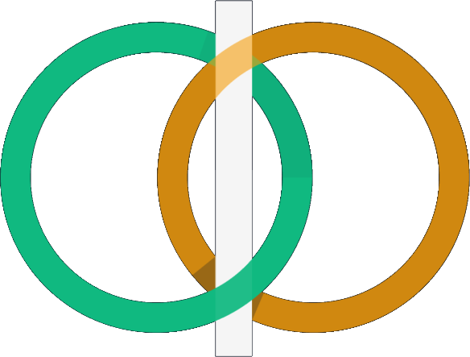
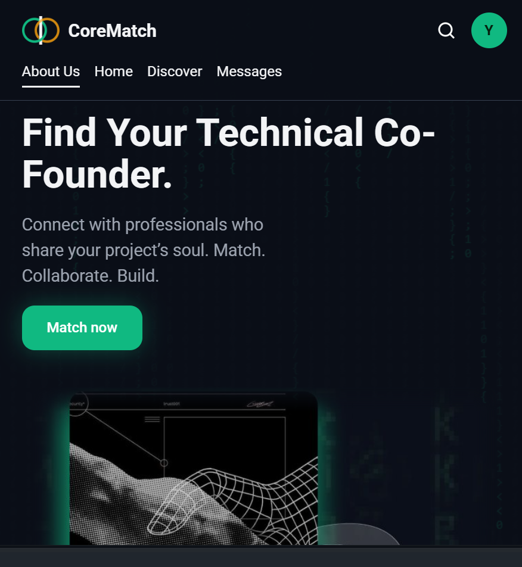
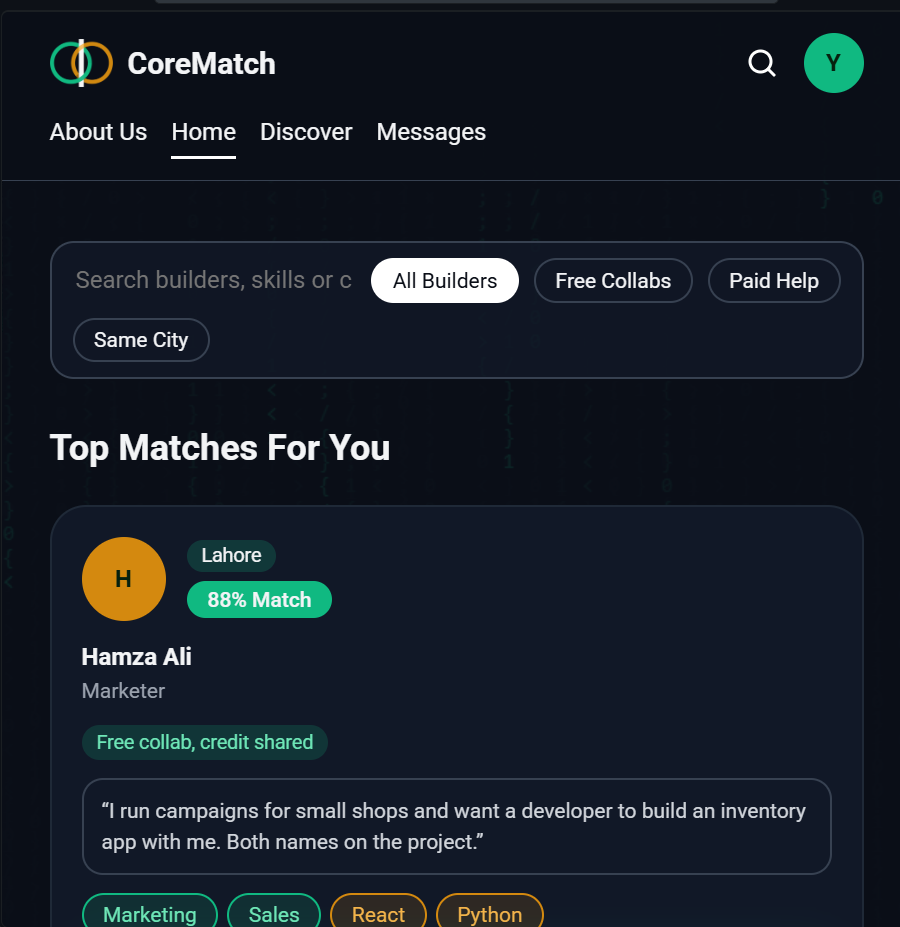
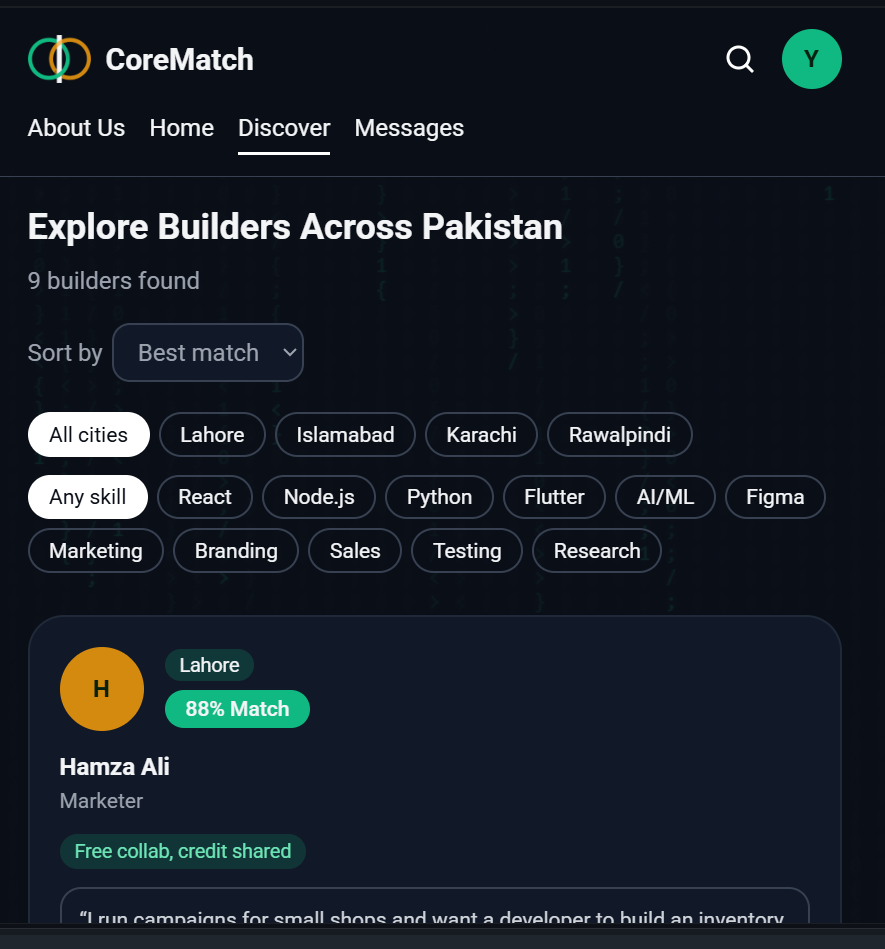
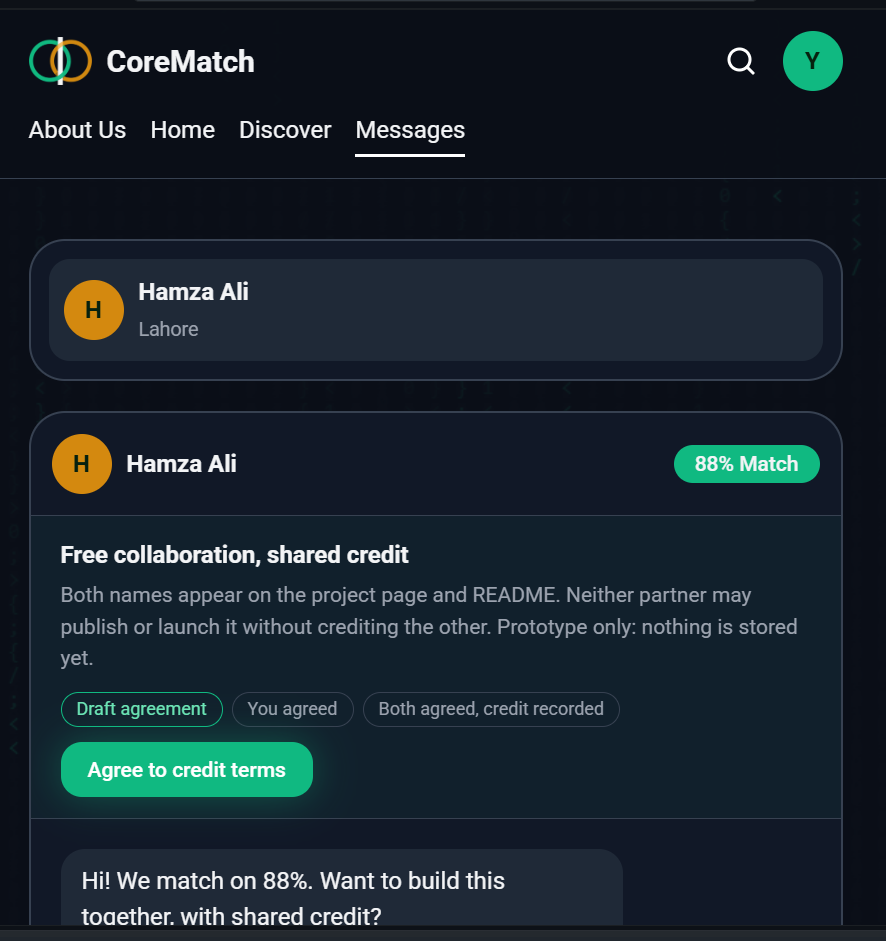

<div align="center">



# CoreMatch

**Match. Collaborate. Build.**

Find your technical co-founder. CoreMatch connects developers, designers and AI builders across Pakistan by the skills they bring and the skills they need.

[](https://YOUR-VERCEL-LINK.vercel.app)
[](LICENSE)


</div>

---

## Why I built this

Great projects rarely start alone, but finding someone with the right skills is hard. Hackathon teams, final-year projects and early startups often stall because nobody on the team covers a key skill. CoreMatch tries to fix that by matching people on **complementary skills**: what you bring and what you need, plus where you are. It supports **free collaborations** (a developer with a marketer, an idea owner with a builder) where both people are credited, and **paid help** (testing, code review, marketing) where payment is held until the work is delivered.

I am a 2nd-year Software Engineering student. I built CoreMatch to learn full-stack web development and to ship a real product.

## Screens

| Landing | Home |
|---|---|
|  |  |

| Discover | Messages |
|---|---|
|  |  |

The full flow has 8 screens: Loading, Landing, Log in, Create account, Profile setup, Home, Discover and Messages.

## Key features

- **Match score:** every builder card shows a compatibility percentage for you.
- **Home feed:** Top Matches, Open Project Ideas, builders in your city, and a profile-strength meter.
- **Discover:** browse everyone, with city and skill filters and sorting (best match, name, city).
- **Free collabs and paid help:** filter by All Builders, Free Collabs, Paid Help or Same City. Free collabs show shared credit, paid jobs show a price.
- **Profile setup:** upload a profile photo, choose your city, the skills you bring, the skills you need, and your project vision.
- **Connect & Build:** opens a chat with that builder in Messages.
- **Agreement panel (prototype):** free collabs go through "both agree to credit each other", and paid jobs go through "payment held, work delivered, payment released". Nothing is stored or charged yet.
- **Responsive and accessible:** works on phones and desktops, with keyboard focus styles and reduced-motion support.

## How the match score works

The score compares two profiles (A is you, B is the other builder):

| Rule | Points |
|---|---|
| Starting score | 40 |
| Each tag B brings that A needs | +16 |
| Each tag A brings that B needs | +16 |
| Same city (Lahore, Islamabad, Karachi, Rawalpindi) | +12 |
| Maximum | 99 |

The function is `score()` in [`js/app.js`](js/app.js). In the full version it will run on the server, so scores are computed from real profiles.

## Tech stack

**Current prototype**

- HTML, CSS and vanilla JavaScript (no build step)
- Sample data is stored in the page, and chat replies are simulated

**Planned**

- Next.js + Tailwind CSS
- Supabase (Auth, PostgreSQL, Realtime messaging)
- Vercel for deployment

## Project structure

```
CoreMatch/
├── index.html        # all screens (hash-based routing: #home, #discover, ...)
├── css/
│   └── style.css     # design tokens, layout, animation
├── js/
│   └── app.js        # sample data, match score, filters, chat, agreement flow
├── assets/
│   ├── logo.png
│   └── hero.jpg
├── docs/
│   └── screenshots/  # images used in this README
├── LICENSE
└── README.md
```

## Design system

Designed first in Figma, then built in code.

| Token | Value |
|---|---|
| Background | `#0A0E17` |
| Card | `#111827` |
| Primary (Brings, match, buttons) | `#10B981` |
| Accent (Needs) | `#D4890F` |
| Font | Roboto |
| Shapes | 24px card radius, pill tags |

Figma file: [view the design](https://YOUR-FIGMA-LINK)

## Run it locally

You only need a browser and Git.

```bash
git clone https://github.com/urfaashahid06-coder/CoreMatch.git
cd CoreMatch
```

Then double-click `index.html`, or serve it:

```bash
npx serve .
```

When the project moves to Next.js, the setup will become `npm install` followed by `npm run dev`.

## Safety and credit

The big idea is that free collaborations are safe for both people. The prototype shows the flow, and the real version needs more than a button:

- A saved, timestamped agreement that both partners confirm
- A shared project page that lists every contributor
- Reporting, moderation and a simple dispute process
- Real payment holding for paid jobs, using a provider that supports Pakistan

This is not legal advice, and the agreement panel does not store anything yet.

## Roadmap

- [x] Frontend prototype with all 8 screens
- [x] Match score, filters and sorting
- [x] Free collab and paid help listings with a mock agreement panel
- [x] Split into separate CSS and JS files
- [x] Move images to an `assets/` folder
- [ ] Migrate to Next.js + Tailwind
- [ ] Supabase Auth and database (profiles, skills, projects)
- [ ] Real-time 1-on-1 messaging
- [ ] Save agreements and credit records in the database
- [ ] Real payment holding (escrow) with a provider that supports Pakistan
- [ ] Deploy the full app on Vercel
- [ ] AI feature: turn rough project ideas into a tech stack and team roles

## How this was built

I designed the UI in Figma myself. I used AI assistance to turn the designs into code and to learn JavaScript coming from a C++ background, then reviewed and edited the code. The backend, database and later features are being built by me step by step, and the commit history shows that progress.

## Contributing

Ideas and bug reports are welcome. Open an issue, or fork the repo and send a pull request. Please use clear commit messages such as `feat:`, `fix:`, `docs:`, `style:` and `refactor:`.

## License

Released under the [MIT License](LICENSE).

## Author

Urfa Shahid, 2nd-year Software Engineering student.
[GitHub](https://github.com/urfaashahid06-coder) · [LinkedIn](https://www.linkedin.com/in/urfa-shahid-598142288/)